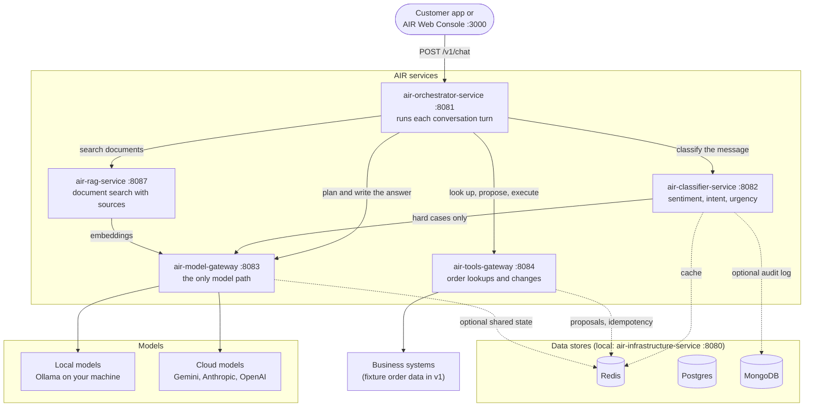
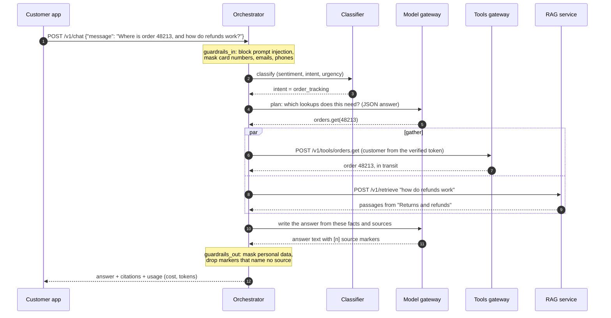
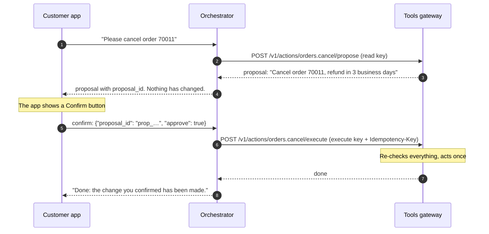
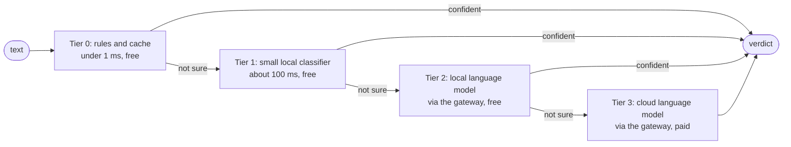

# AIR platform overview

**Read this first.** It explains what the AIR platform is, what each of the seven
repositories does, and how a customer message travels through them. It assumes you
write backend code (Java, Go, Node or Python) or run infrastructure, and does not
assume you have built anything with a language model before. Unfamiliar terms are
explained in [02-concepts.md](02-concepts.md).

| Next | For |
| --- | --- |
| [02-concepts.md](02-concepts.md) | The AI vocabulary used in every repo, in backend terms |
| [03-local-setup.md](03-local-setup.md) | Running the whole platform on your laptop |
| [04-testing.md](04-testing.md) | How each repo is tested, and how to report a bug |
| [05-handover.md](05-handover.md) | What is finished, what is open, and what to do before production |
| [GCP deployment guide](../../../air-infrastructure-service/docs/02-gcp-deployment.md) and [GKE runbook](../../../air-infrastructure-service/docs/03-gke-runbook.md) | DevOps: what each service needs in GCP, and deploying to UAT and production |

## 1. What AIR is

AIR is a set of small HTTP services that together answer a customer's question about
a shop, for example "where is my order?" or "can I return this kettle?", and can carry
out a change such as cancelling an order after the customer explicitly confirms it.

A language model writes the answer, but it is never trusted with anything that
matters. Everything around it is ordinary, deterministic backend code:

- The model can only **read** through declared lookups, and only the calling
  customer's own data.
- The model can never **change** anything. It can only *propose* a change. The change
  happens when the customer confirms it with a structured field that plain text can't
  fake.
- Every model call goes through **one gateway**, which holds the provider keys,
  enforces budgets and fails over between providers.
- Every service authenticates its callers with an API key, validates its input
  strictly, and reports errors in one format (RFC 9457 `application/problem+json`).

The development data is a fictional shop called **Brightcart** (tenant `brightcart`),
with a few customers (`cust_1001`, `cust_1002`, `cust_1003`) and a small help-centre
corpus. A second tenant, `othershop`, exists only to prove that tenants can't see each
other's data.

## 2. The repositories

| Repository | Port | Language | What it does | Calls a model? |
| --- | --- | --- | --- | --- |
| **air-web-console** (this repo) | 3000 | TypeScript, Next.js | Test console for all five services, and the entry point for documentation and bug reports. Local tool, not deployed | No |
| **air-orchestrator-service** | 8081 | Python, FastAPI | The front door. Runs each conversation turn: checks the message, plans, gathers facts from the other services, asks the model for an answer, checks the answer | Through the gateway |
| **air-classifier-service** | 8082 | Python, FastAPI | Labels a text: sentiment, intent, urgency, routing. Cheap rules first, a model only when needed | Through the gateway |
| **air-model-gateway** | 8083 | Python, FastAPI | The only path to any language model, local or cloud. Keys, routing, failover, budgets, cache | Yes: it is the model path |
| **air-tools-gateway** | 8084 | TypeScript, Fastify | The only path to business systems: order lookups, and changes behind propose then execute | No, by rule |
| **air-rag-service** | 8087 | Python, FastAPI | Searches the help-centre documents and returns passages with their sources | Embeddings only, through the gateway |
| **air-infrastructure-service** | 8080 | Go | DevOps' repository. The local development stack (Redis, Postgres, MongoDB and a small credential broker; in GCP, managed services replace it), and in `gke/` the Helm charts and Terraform that deploy the five services above | No |

Ports 8085 and 8086 are reserved for services that are not built (`air-action` will
not be built; `air-recommender` is not started).

### Older names you will still see

The repositories were renamed during development. Code comments, older documents and
some identifiers still use the earlier names. They all mean the same projects:

| You may read | It means |
| --- | --- |
| `air-infra` | air-infrastructure-service. Also the name the orchestrator reports it under in `/v1/ready` |
| `air-llm` | air-model-gateway. The console's `/api/llm` route and `LLM_*` settings keep the old name on purpose |
| `air-platform` | air-orchestrator-service |
| `air-tools` | air-tools-gateway |
| `air-classifier`, `air-rag` | The short names of the classifier and RAG services. They are also wire labels (API responses, metrics), so they are not renamed |
| `air-client` | The earlier test client. air-web-console replaced it; the gateway's development token `air-client-dev` still carries the name |

Three identifiers are external contracts and must not be "fixed": the classifier's
`AIR_CLASSIFIER__` settings prefix and `air_classifier_*` metric prefix, and the Docker
network name `air-net`.

## 3. How the services fit together

Solid arrows are HTTP calls. Dotted arrows are data-store connections. Services never
import each other's code: every arrow is a versioned REST call with its own API key.

Things worth noticing:

- **Only the orchestrator talks to the other services.** The classifier, RAG service
  and tools gateway don't call each other.
- **Three services reach a model, and all three go through the gateway.** No other
  repository holds a provider SDK or a provider API key.
- **The tools gateway makes no model call at all.** The orchestrator decides which
  capability a conversation needs; the tools gateway runs it deterministically.
- **Postgres is provisioned but nothing uses it yet.** MongoDB is used only by the
  classifier's optional audit log, which is off by default.
- **The console calls all five services directly** (not shown), through its own
  server, to test each one alone.

## 4. One conversation turn, step by step

The orchestrator runs every message through the same fixed list of stages. Each stage
reports `ok`, `skipped` (with a reason), `degraded` or `blocked`, so a response always
shows what really ran.

The stages, in order:

| Stage | What happens | Service used |
| --- | --- | --- |
| `guardrails_in` | Refuses prompt-injection attempts; masks personal data before anything is stored or sent to a model; detects a request for a human | none (pure code) |
| `context` | Loads the conversation so far | in-memory session store |
| `cache` | Not built yet; always `skipped` | none |
| `classify` | Sentiment, intent and urgency of the message | air-classifier-service |
| `plan` | Decides which lookups or change the message needs | air-model-gateway |
| `gather` | Runs the lookups, searches documents, proposes or executes a change | air-tools-gateway, air-rag-service |
| `synthesise` | The model writes the answer from the gathered facts | air-model-gateway |
| `guardrails_out` | Masks personal data in the answer and cleans up citations | none |
| `persist` | Saves the turn to the session | in-memory session store |

A missing service narrows the answer rather than failing it. With the RAG service
down, the turn still answers and reports `degraded`. Only the model gateway is
required for an answer.

## 5. How a change is made safely

A change (cancelling an order) always takes two turns. The model takes part in the
first one only.

- Typing "yes, go ahead" does **not** execute anything. Only the structured `confirm`
  field does. A successful prompt injection therefore can't cause a write.
- Propose and execute use **different API keys**. The component that reads has no
  access to the execute key.
- Execute is **idempotent**: a retry with the same `Idempotency-Key` returns the first
  answer and never acts twice.

## 6. How the classifier saves money

Most text is easy to label. The classifier tries the cheapest method first and climbs
only when the result isn't confident enough. The response records how far it climbed
and why.

A failed tier never becomes an error: the best lower-tier verdict is returned with
`degraded: true`.

## 7. How the gateway chooses a model

Callers never name a model. They ask for a **class**, and the gateway's
`deploy/routing.yaml` maps each class to an ordered list of models. If the first
fails, the next one is tried.

| Class | Meaning | Today's first choice |
| --- | --- | --- |
| `local` | Stays on our own hardware; costs nothing | Ollama `llama3.2:3b` |
| `cloud` | A cloud model | Gemini `gemini-2.5-flash`, then Anthropic, then OpenAI |
| `auto` | Cloud first, local as the last resort | Same cloud list, then Ollama |
| `local-768-v1` | The embedding model the RAG index is built with | Ollama `nomic-embed-text` |

Changing a model, a price or a per-service budget is a configuration edit in the
gateway repository, not a code change in any caller.

## 8. Conventions every service shares

Learn these once and every repository becomes familiar:

| Convention | Detail |
| --- | --- |
| Routes | Everything under `/v1`. `GET /v1/health` (is the process up; no dependency), `GET /v1/ready` (can it serve; names what is missing), `GET /v1/capabilities` (what this build offers), `GET /metrics` (Prometheus) |
| Authentication | `X-API-Key` header. Keys are stored as salted SHA-256 digests, never raw. The tenant comes from the key, never from the request body |
| Errors | RFC 9457 `application/problem+json` with a stable `type` or `code` and a `request_id` |
| Tracing | `X-Request-ID` is echoed back and forwarded downstream, so one id follows a request through every service's logs |
| Validation | Unknown fields are rejected (422 or 400), not ignored |
| Configuration | Environment variables only, with a per-service prefix and `__` for nesting. `.env.example` is committed and documents every key; `make env` copies it to an untracked `.env` |
| Commands | `make help` lists every target. `make check` is the gate before a change is done. `make run` runs on the host, `make up` runs in Docker |
| Containers | Multi-stage build, non-root user, health check on `/v1/health` only |
| Who owns what | Each service's repository owns its code, `Dockerfile`, image and settings. air-infrastructure-service owns how the images are deployed. This repository owns how a developer gets everything running locally |
| Deployment | `make image-push`, `make deploy DEPLOY_ENV=uat\|prod` and `make deploy-smoke` in each of the five services; they call the charts in air-infrastructure-service |
| Logs | Structured (JSON in containers). Raw API keys and customer text are never logged |

## 9. Where to read next in each repository

| Repository | Start with | Then |
| --- | --- | --- |
| air-orchestrator-service | `README.md` | `docs/01-hld.md`, `docs/02-lld.md` §15 (build status), `docs/specs/README.md` |
| air-classifier-service | `README.md` | `docs/overview.md`, `docs/01-hld.md`, `docs/02-lld.md` |
| air-model-gateway | `README.md` and `docs/air-model-gateway-design.pdf` | `docs/overview.md`, `docs/04-integration.md`, `docs/03-deployment.md` |
| air-tools-gateway | `README.md` | `contract/openapi.yaml`, `docs/handoff.md`, `docs/enhancements.md` |
| air-rag-service | `README.md` | `docs/00-plan.md` |
| air-infrastructure-service | `README.md` | `docs/01-setup.md` (local stack); `docs/02-gcp-deployment.md`, `docs/03-gke-runbook.md`, `gke/README.md` (cloud) |

Every repository also has a `CLAUDE.md` (or `AGENTS.md`). It is written for AI coding
assistants, but it is also the most compact engineering guide to that codebase: the
invariants, the commands and the traps. Read it before your first change.
